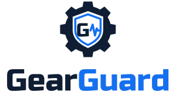

# GearGuard Dashboard



Web dashboard for GearGuard, formerly SiagaMesin (AMD Developer Hackathon ACT III, Intelligent Industry track).
Shows machine status, predictive alerts with explanations, operator downtime reasons from voice notes,
Availability and the downtime Pareto.

Stack: Next.js 16 (App Router, static export), Tailwind CSS 4, ECharts, IBM Plex Sans.

## Run

```bash
npm install
cp .env.example .env.local   # set NEXT_PUBLIC_API_URL, see below
npm run dev                  # http://localhost:3000
```

## Data source

| `NEXT_PUBLIC_API_URL` | What the dashboard shows | Badge in the header |
|---|---|---|
| `https://yosua.tailf140ab.ts.net` | Real backend on the Raspberry Pi. M1 is the live rig, M2–M4 come from the backend's replay simulator | "Live data · M1" or "Simulated data" |
| empty | Built-in browser simulator with the same response shapes. Backup for when the Pi is unreachable | "Demo data (offline)" |

The browser simulator repeats a scripted scenario every 2 minutes: M3 starts stopped and waits for the
operator, gets a voice-note reason at 40 s; M2 vibration creeps up from 45 s and raises an alert, stops at
80 s and is answered at 95 s.

`NEXT_PUBLIC_API_URL` is read at build time. After changing it on Vercel, redeploy.

Optional: `NEXT_PUBLIC_DOWNTIME_COST_PER_MIN` sets the default cost of one minute of unplanned downtime
(Rupiah, default 15000). Anyone can change it on the Reports page; their value is kept in their browser.

## Features

- **Overview**: line diagram, shift KPIs with downtime cost, machine cards with live vibration, predictive alerts
  (full explanation, "AI · Qwen on AMD" or "Rule-based" badge, manual pages to check), today's events with voice-note
  transcripts and "Needs review" marks
- **Machines**: current, vibration and temperature with alert limits; stops and operator answers per machine
- **Reports**: state timeline per machine (running, anomaly, unplanned stop, scheduled break), downtime Pareto,
  availability, and a maintenance table with downtime cost, breakdowns, MTTR and MTBF
  (breakdown = stop for a mechanical, electrical or overheat reason)
- **Running on AMD**: where each AI step runs (Whisper on the Raspberry Pi, Qwen on AMD Token Factory), with calls,
  latency and success rate
- **Lead time**: an alert followed by a stop shows "warned 85 s before the stop"; Reports shows the average.
  Computed in the browser from `/alerts` and `/events`
- **Alert limits** (machine page): drag "normal" and "alert above" per sensor, or fill them from the last 15 minutes
  of running data, then save to the backend
- **Notifications**: a notice for every new alert, stop and operator answer; the bell in the header turns on a sound

## Backend contract

The API is owned by role 2: [docs/role4-frontend.md](https://github.com/YosuaMW/GearGuard/blob/main/docs/role4-frontend.md).
The same shapes are typed in [`src/lib/types.ts`](src/lib/types.ts). Times arrive in UTC and are shown in WIB.

| Dashboard part | Endpoint | Poll |
|---|---|---|
| Line diagram, machine cards, alert limit lines (`baseline.*.limit_high`) | `/machines` | 1 s |
| Vibration sparklines, machine charts | `/telemetry?minutes=2` | 2 s |
| Predictive alerts, "anomaly alert raised" rows | `/alerts?range=today` | 2 s |
| Today on the line, stops and operator answers | `/events?range=today` | 2 s |
| KPI row and data badge | `/summary?range=shift` | 5 s |
| Reports | `/pareto`, `/availability` (shift, today, 24 h) | 10 s |
| Running on AMD | `/ai-usage` | 10 s |

The backend must allow the dashboard's origin in `CORS_ORIGINS` (send the Vercel URL to role 2).

### Alert limits (needs one endpoint from role 2)

`PUT /machines/{id}/limits` with any subset of sensors:

```json
{ "vib_rms": { "normal": 1.80, "limit_high": 2.40 }, "temp_c": { "normal": 29.0, "limit_high": 34.0 } }
```

The backend stores it in `baselines.stats` as `median = normal`, `scale = (limit_high − normal) / ANOMALY_Z_ALERT`
(the worker reloads baselines every 60 s) and returns the machine's new `baseline` in the `/machines` shape.
CORS must allow `PUT` and the `Content-Type` header. Until the endpoint exists, saving shows an error and nothing
changes. With the browser simulator, saved limits last until the page reloads.

## Deploy (Vercel)

1. Import the repo on vercel.com. If the dashboard lives in a subfolder, set Root Directory to it.
2. Add `NEXT_PUBLIC_API_URL` under Environment Variables, then Deploy.
3. Optional backup: a second Vercel project from the same repo with `NEXT_PUBLIC_API_URL` empty.

`npm run build` writes plain HTML/CSS/JS to `out/`, so any static web server also works.

## Where things are

```
src/lib/api.ts        every backend call goes through here (add a login token here later)
src/lib/mock.ts       browser simulator, used when NEXT_PUBLIC_API_URL is empty
src/lib/plant.tsx     polls machines/telemetry/alerts/events/summary once for the whole app
src/lib/maintenance.ts  MTTR / MTBF / unplanned downtime calculations
src/lib/prefs.ts      per-browser settings (downtime cost, sound)
src/lib/leadtime.ts   how long before a stop each alert warned
src/app/page.tsx      Overview
src/app/machines/     Machine detail (ids listed in generateStaticParams)
src/app/reports/      Pareto and availability
src/app/amd/          Running on AMD
```

## Brand

All logo files are in `public/brand/`, each as SVG and transparent PNG, with a `-dark` version for dark backgrounds:

| File | Use |
|---|---|
| `gearguard-logo-stacked` | Cover, title slide (symbol above the name) |
| `gearguard-logo` | Header, README, slide footer (symbol beside the name) |
| `gearguard-mark` | Full symbol with the G, 100 px and larger |
| `gearguard-icon` | Simple symbol without the G, for small sizes; also the browser tab icon (`src/app/icon.svg`) |

Navy `#0f1e33`, blue `#1570ef`. Wordmark set in Russo One, outlined, so no font is needed.

## Design rule

Grey when normal, colour only when abnormal (ISA-101 high-performance HMI). Amber = anomaly,
red = stopped, dashed grey = offline. Keep new UI to that rule so problems stay the first thing the eye finds.
